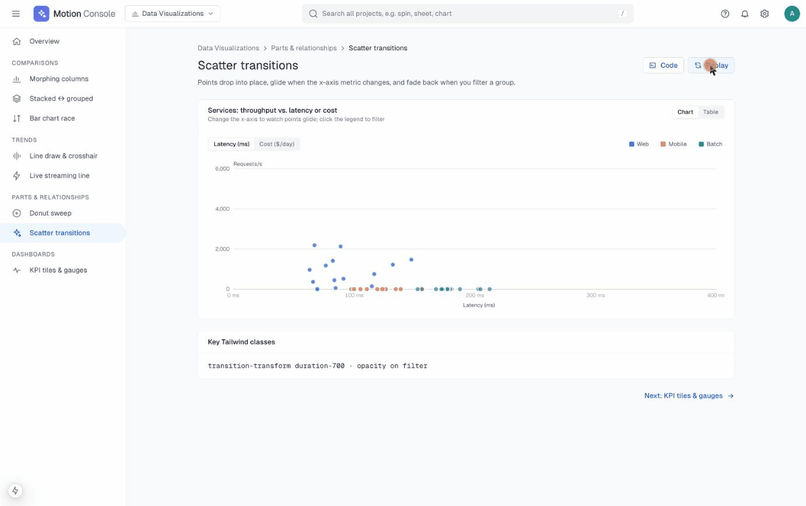

# demo-animations

A [Next.js](https://nextjs.org) and [Tailwind CSS](https://tailwindcss.com) playground for building web animation demos. The app lives in [`frontend_tailwind/`](frontend_tailwind/).

It's laid out like a cloud console: pick a project from the header, browse its demos in the sidebar, or search across every project. There are three projects:

| Project | URL | What's in it |
| --- | --- | --- |
| **Web Applications** | `/web` | Motion basics (fades, slides, bounce, spinners, pulse, wave, 3D flips, orbit, typewriter, gradients) and tables & data (row add/remove, animated sorting, live cells, an Excel-style spreadsheet, expandable rows, skeleton loading, data bars and heatmaps, filtering). |
| **iOS Animations** | `/ios` | Everyday iOS workflows inside a phone frame: Dynamic Island, notification banners, app launch and jiggle mode, alerts and action sheets, push navigation, a draggable bottom sheet, swipe actions, pull to refresh, switches and controls, and chat bubbles. |
| **Data Visualizations** | `/charts` | Animated charts with tooltips and table views: morphing columns, stacked ↔ grouped bars, a bar chart race, line draw with crosshair, a live streaming line, a donut sweep, scatter transitions, and KPI tiles with gauges. |



Every demo page has a **Code** button that shows the demo's rendered HTML and the exact CSS it uses, with buttons to copy either one or download a standalone `.html` file.

## Quick start

You need [Docker](https://docs.docker.com/get-docker/) with Compose v2.

```sh
git clone https://github.com/kavisek/demo-animations.git
cd demo-animations
make start
```

Open <http://localhost:3000>. The source folder is mounted into the container, so edits under `frontend_tailwind/` hot-reload in the browser.

| Command | What it does |
| --- | --- |
| `make start` | Build the dev image and start the app in the background |
| `make stop` | Stop and remove the dev container |
| `make logs` | Follow the dev server's output |
| `make attach` | Open a shell in the running dev container |
| `make build-prod` | Build the production image (`next build`, served with `next start`) |
| `make run-prod` | Build and run the production image on <http://localhost:3000> |

If you add a dependency, run `make start` again so the image installs it.

### Without Docker

You need Node.js 22.

```sh
cd frontend_tailwind
npm ci
npm run dev
```

## Project layout

```text
.
├── compose.yaml          # dev environment with hot reloading
├── Dockerfile.dev        # dev image (next dev)
├── Dockerfile            # production image (next build + next start)
├── Makefile
└── frontend_tailwind/    # Next.js app (App Router, Tailwind CSS)
    └── src/app/
```

## Contributing

See [CONTRIBUTING.md](CONTRIBUTING.md). Report security issues privately as described in [SECURITY.md](SECURITY.md).

## License

[MIT](LICENSE)
